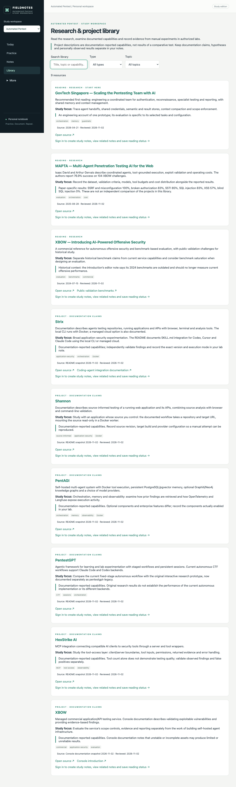
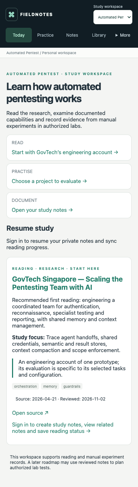
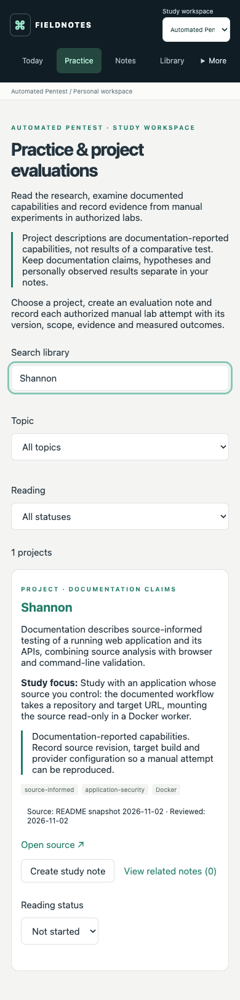
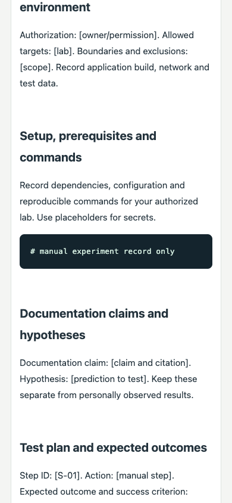

# GH-3: Automated Pentest workspace

Review evidence, 2026-11-02 (Asia/Singapore). Issue: [#3](https://github.com/Perryong/oscp-exam-notes/issues/3). Base: `codex/structured-study-templates` at `5924d4a2b1af32208782ea01eae67647bd23875a`.

## Delivered behavior

The third workspace has Today, Practice, Notes, Library and Trash routes under `/automated-pentest`, with the existing desktop/mobile navigation and editor. The public library contains three reading entries and six projects, text/type/topic filters, canonical source links, dated provenance and explicit limitations on reported claims. Signed-in users can filter and sync reading status, create source-attributed research or authorized-lab evaluation notes, find related notes and return to the source. Blank notes remain available. Visiting a resource does not create a private note.

The catalog records documentation review dates and README blob revisions where applicable. GovTech is the first reading; MAPTA's 76.9% on 104 challenges is attributed to the paper with class-specific limitations; XBOW's introduction is marked historical with its benchmark warning. Supplementary benchmark and Console links are included. No tools, credentials, scanners or autonomous runners are added.

## Compatibility and rollout

- Missing workspace fields still mean OSCP. Unknown workspaces fail validation explicitly. Existing resource datasets, dependencies and account behavior are unchanged.
- Notes, progress and linked targets use `automated-pentest`; client validation and Firestore rules reject incompatible targets, spoofed seed identities and workspace changes. Owner access restrictions remain in place.
- Public metadata is bundled and merged idempotently in memory. Only explicit user actions create private notes or progress. No database seeding job, collection migration or bulk rewrite is required.
- The current v2 full-account backup format is retained; v1 remains supported for OSCP. Automated Pentest note links, source attribution, trash, history and recovery records are preserved through validation/remapping. Existing seed progress is reused rather than overwritten during restore. Unsupported workspace data is rejected instead of silently dropped.
- The existing draft-first IndexedDB, revision/conflict, attachment and offline/PWA mechanisms are reused. Existing records are not rewritten by this feature.
- Deployment is a separate, human-authorized step: publish the tested backward-compatible Firestore rules before the new frontend. No new indexes or environment variables are required. Use a separate test Firebase project for hosted previews; local demo configuration must not be deployed.
- After any future deployment, verify only clearly named disposable test records. Keep the expanded rules and data if reverting the UI. Older clients do not recognize Automated Pentest records, so do not treat an old client as a safe full-account backup/restore tool after this workspace has data.

## Validation

The [operator resume handoff](https://github.com/Perryong/oscp-exam-notes/issues/3#issuecomment-6561389865) records host-browser verification after the worker sandbox prevented Chrome launch. On resume, all **171 files** in the operator's SHA-256 source manifest matched this checkout exactly. Application and test logic were not changed during delivery. Browser checks were reused as explicitly requested by the operator.

| Check | Result |
| --- | --- |
| `npm test` | 121 unit tests and 10 importer tests passed; repeated on resume |
| `VITE_FIREBASE_MODE=emulator npm run build` | TypeScript, Vite and PWA generation passed; repeated on resume |
| `npm run test:emulators` rules/integration stages | 15 Firestore-rule tests and 18 integration tests passed |
| Development Playwright suite against demo emulators | 20 tests passed in the corrected host run |
| Emulator-mode build and `test:release` | 5 release/offline tests passed in the host run |
| Changed `src/` and `e2e/` files, Prettier check | Passed |
| `git diff --check` | Passed |
| Repository-wide `npm run format:check` | Existing warnings in `src/oscp/PracticeTracks.test.tsx`, `src/oscp/resources.json`, `src/walkthroughs/study-guides.json`; each verified byte-identical to the baseline |

The first host emulator run passed rules/integration but failed one browser assertion: a resource changed to Completed correctly disappeared from the Reading filter before the assertion checked Synced. The operator corrected the test to select Completed first; all 20 browser tests and all 5 release tests then passed. That correction is preserved. Offline test scenarios deliberately produce connection warnings. The build retains the existing large-chunk warning.

Coverage includes anonymous/public library access, all nine entries, search/filtering, source links, both templates, blank-note creation, reading progress across sessions, note sync/reload, offline edit recovery, workspace isolation, legacy content preservation, seed restore idempotency, internal Markdown links, history/recovery and adversarial rules checks. Mobile checks cover project-to-note creation, editable command blocks, return-to-study navigation, recent notes and trash. Existing OSCP/AI-300 browser and unit coverage also passed.

The implementation and resume validation above used `demo-oscp-notebook` Auth/Firestore emulators and synthetic accounts. Resume runtime: Node v26.13.0 and Java 21.0.12.1. The later explicitly authorized production rollout, preservation of live import rules, 16-rule/18-integration retest, live browser checks and original-data comparison are recorded in [the deployment record](../../deployment.md#automated-pentest-production-deployment-2026-11-02).

## Screenshots

Captured by the operator's passing local browser run and inspected on resume. Public library/Today and synthetic signed-in Practice/editor data only. The mobile editor capture shows the command and evidence sections at its current scroll position.

### Desktop library

### Mobile Today

### Mobile Practice

### Mobile evaluation editor

